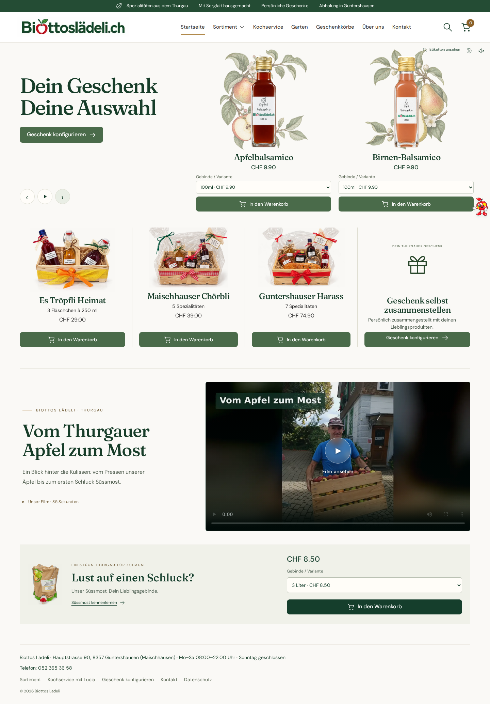
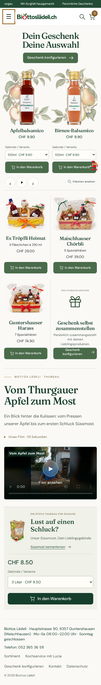

# Botanische Startseite

Die freigegebene Gestaltung stellt Apfelbalsamico und Birnen-Balsamico im vorhandenen Karussell in den Mittelpunkt. Die drei Geschenkprodukte und der Geschenk-Konfigurator bleiben direkt darunter erhalten. Apfelessig bleibt im Shopify-Sortiment erreichbar.

## Gestaltung

- Warmes Creme, Waldgrün und Salbeigrün, feine Trennlinien statt schwebender Karten
- Lokal bereitgestellte Fraunces und DM Sans; die OFL-Lizenzen liegen neben den Schriftdateien
- Zwei getrennte dekorative Apfel-/Birnenillustrationen; mit ImageGen erzeugt, ohne Produktbilder zu generieren
- Unverändertes Original-Logo; Originalfotos der beiden 100-ml-Flaschen aus Shopify, nur verlustarm zugeschnitten und als WebP exportiert
- Gleich hohe Flaschenbilder und gleiche Grundlinie; fotografische Ränder werden unabhängig von der Quellbildgrösse normalisiert
- Alle Gebinde bleiben wählbar; die abgebildeten 100 ml stehen zunächst im Vordergrund. Die native Shopify-Variantenreihenfolge bleibt im gemeinsamen Katalog unverändert
- Vorhandene Texte erhalten; nur die freigegebenen Satzzeichen in „Dein Geschenk / Deine Auswahl“ entfernt

## Funktionsschutz

`src/server.js`, `src/storefront.js`, `src/queries.js`, `public/assets/imagefilm.js` und `public/assets/most-gallery.js` sind unverändert. Bestehende Produktformulare, Attribute und Event-Handler werden wiederverwendet. Alle fünf bisherigen Karussellansichten, Mosti, Etikettenansicht, Suche, Navigation, Film und Kaufwege bleiben erhalten. Die neuen Styles werden ausschliesslich auf der Startseite geladen.

Die redaktionelle Karussell-Auswahl und ihre Etikettenübersicht enthalten jetzt die zwei freigegebenen Balsamicos statt der veralteten sieben Sorten. Das ist keine Änderung oder Löschung von Shopify-Produkten.

## Prüfung

- `npm ci`, `npm run check`, `npm test`: 61/61 Tests erfolgreich
- Chromium bei 320, 375, 390, 768, 1024 und 1440 px: kein horizontaler Überlauf, beide Flaschen gleich hoch, Kaufbuttons innerhalb des Karussells
- Alle fünf Karussellansichten, Etikettendialog und mobile Navigation geprüft
- Echter Shopify-Testwarenkorb: Apfelbalsamico 250 ml hinzugefügt, Preiswechsel geprüft, Menge erhöht, über Neuladen erhalten und wieder entfernt
- Bestehender Checkout-Endpunkt liefert eine sichere Shopify-Checkout-Adresse; keine Bestellung und keine Zahlung ausgelöst
- Geschenk-Konfigurator: Auswahl und Grusstext bedienbar
- Film startet nach bewusster Wiedergabeaktion
- Keine JavaScript-Laufzeitfehler

Die isolierte Browserumgebung kann Shopify-Bildadressen nicht direkt abrufen. Für die visuelle Prüfung wurden die Originalantworten vom Shopify-CDN über die Host-Verbindung bytegleich an den Browser weitergegeben. Die Anwendung selbst und ihre Bildadressen wurden dafür nicht verändert. Die öffentlich gehostete Vorschau und reale Mobilgeräte sind vor Veröffentlichung noch zu prüfen.

## Originalquellen

- Apfelbalsamico: Shopify-Datei `1000007749.png`, Stand 25. Oktober 2026
- Birnen-Balsamico: Shopify-Datei `1000007619.png`, Stand 25. Oktober 2026
- Geschenkfotos und sonstige Produktdaten: weiterhin direkt aus Shopify
- Die Shopify-Varianten 250/500 ml beim Apfelbalsamico verwenden derzeit dasselbe Originalfoto wie 100 ml. Die Anwendung übernimmt diese Bildzuordnung unverändert

## Bildschirmansichten

## Mosti auf ausdrücklichen Wunsch vereinfacht

Die Flaschenanimation, ihre Hover-Auslöser, Zirkusabläufe, Musik und Ton-/Bewegungsschalter wurden entfernt. Mosti wechselt nur nach Klick oder Tastaturaktivierung für 700 ms zum Zwinkerbild. Produktlinks, Kaufwege, Etikettenansicht und Karussellsteuerung bleiben erhalten.

## Freigegebene Produktrotation

Das bestehende Karussell erhält zusätzliche Ansichten mit maximal zwei verfügbaren Shopprodukten mit Originalfoto. Bereits separat gezeigte Balsamicos, Süssmost und Geschenkkörbe werden dort nicht doppelt angezeigt. Saisonale Produkte behalten ihre Kategorie; mehr als zwei erhalten weitere Saisonansichten. Die Anzahl und Beschriftung der Folien folgt dem Shopify-Katalog. Kauf- und Variantenhandler bleiben unverändert; die neuen Produktansichten nutzen ihre bestehenden Klassen und Attribute. Pfeile, Pausieren und reduzierte Bewegung gelten weiterhin für alle Ansichten. Bei ungerader Produktzahl erscheint das letzte Produkt allein.

## Freigegebene Kaufgestaltung und Bildkorrekturen

Kaufbuttons sind einheitlich dunkelgrün, die Produktrotation verwendet «In den Warenkorb». Informationslinks im Startseiten-Karussell und beim Konfigurator-Einstieg erscheinen unterstrichen. Produktseiten erhalten die freigegebenen Hinweise zum Warenkorb und warme Typografie/Farben; alle bestehenden Felder, Formulare und Handler bleiben erhalten. Auch Konfigurator-Kaufbutton und Warenkorb-Checkout verwenden Grün.

Lucia und Firmengeschenk erhalten grössere, zentrierte Bildausschnitte. Die Süssmost-Gebinde erscheinen als CSS-Ausschnitte des unveränderten Originalbildes auf ihren bestehenden Klickflächen. Alle drei Grössen öffnen weiterhin ihre passende Kaufansicht. Detaillierte SVG-Silhouetten maskieren nur den Hintergrund der unveränderten Balsamico-Fotos, einschliesslich der bei Variantenwechsel geladenen Shopify-Originale. Etiketten bleiben deckend. Es wurden keine Produktfotos, Logos oder Etiketten generiert oder ersetzt.
